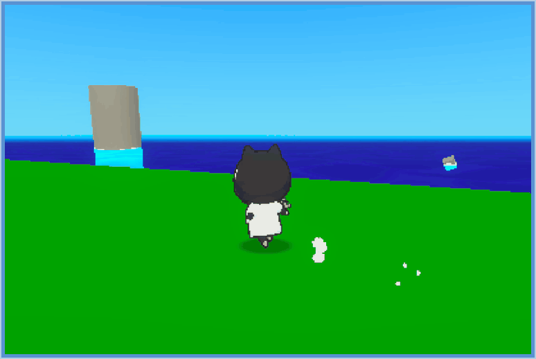
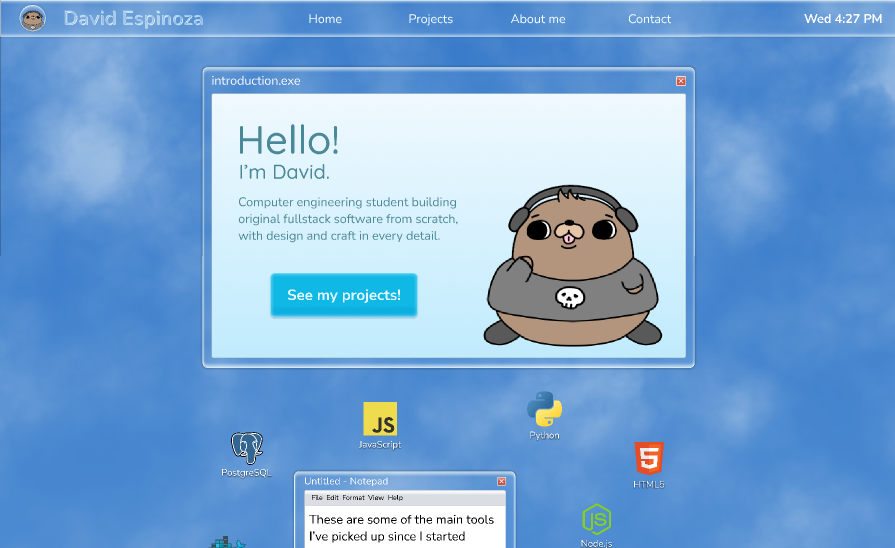
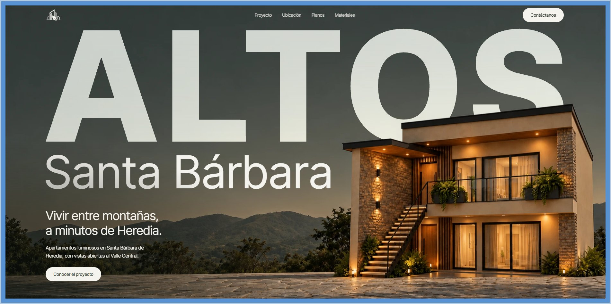

### About Me

Computer Engineering student at **Tecnológico de Costa Rica (TEC)**, working toward becoming a **Full-Stack Developer** with a growing focus on cloud and AI. Artistic at heart: I care as much about how something *looks and feels* as how it works, and I love understanding things well enough to build them from scratch.

- Currently learning **AWS**, **Figma** and going deeper into **React**
- Reach me on **[LinkedIn](https://www.linkedin.com/in/jdavid-espinoza)**

### Tech Stack

<table>
  <tr>
    <td><b>Languages &amp; Frameworks</b></td>
    <td></td>
  </tr>
  <tr>
    <td><b>Databases &amp; Tools</b></td>
    <td></td>
  </tr>
  <tr>
    <td><b>Game Dev</b></td>
    <td></td>
  </tr>
  <tr>
    <td><b>Currently Learning</b></td>
    <td></td>
  </tr>
</table>

### Currently Working On

<h3>Uminori</h3>

  

A cozy 3D exploration and fishing game set on islands surrounded by the sea. Retro, low-res look.

<b>Built with:</b> Unity · C# · Blender · Figma

<h3>Portfolio 2.0</h3>

  

Rebuilding my personal portfolio from scratch and no AI, with a retro-desktop aesthetic. Designing in Figma now, development starts next.

<b>Built with:</b> Figma · React · TypeScript · HTML5 · CSS3

<h3>Altos de Santa Bárbara</h3>

  

Website for an apartment project in Santa Bárbara de Heredia, Costa Rica. A <b>freelance project</b>, not a university assignment: I designed, built and deployed the whole site myself for a team of Construction Engineering students at TEC, who designed the building.

Layered full-screen hero, interactive location map, floor plans and materials gallery, with separate desktop and mobile layouts.

<b>Built with:</b> Next.js · React · TypeScript · Tailwind CSS · MapLibre · Vercel

Source code is private because it contains the client's plans and renders.

*"Code, design, games. Usually all three at once, and I love it."*

