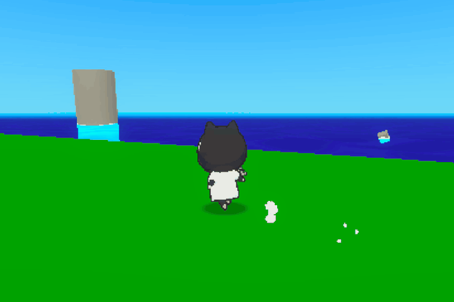
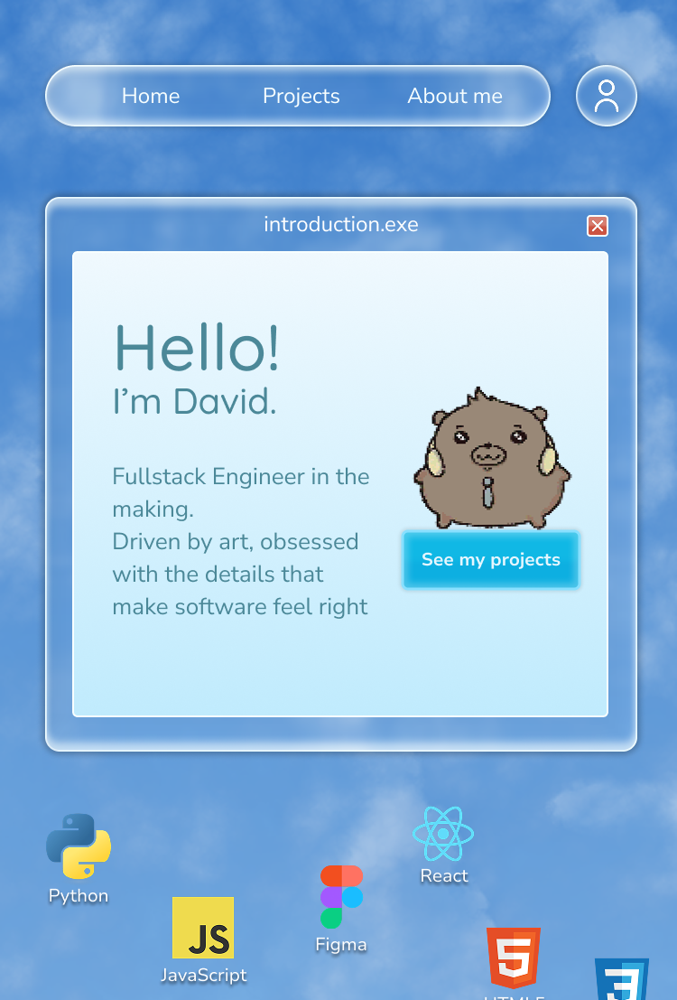

### About Me

Computer Engineering student at **Tecnológico de Costa Rica (TEC)**, working toward becoming a **Full-Stack Developer** with a growing focus on cloud and AI. Artistic at heart: I care as much about how something *looks and feels* as how it works, and I love understanding things well enough to build them from scratch.

- Currently learning **AWS**, **Figma** and going deeper into **React**
- Reach me on **[LinkedIn](https://www.linkedin.com/in/jdavid-espinoza)**

### Tech Stack

<table>
  <tr>
    <td><b>Languages &amp; Frameworks</b></td>
    <td></td>
  </tr>
  <tr>
    <td><b>Databases &amp; Tools</b></td>
    <td></td>
  </tr>
  <tr>
    <td><b>Game Dev</b></td>
    <td></td>
  </tr>
  <tr>
    <td><b>Currently Learning</b></td>
    <td></td>
  </tr>
</table>

### Currently Working On

<table>
  <tr>
    <td width="55%" align="center">
      
    </td>
    <td width="45%">
      <h3>Uminori</h3>
      
A cozy 3D exploration game set on quiet islands surrounded by the sea. Retro, low-res look. More to come...

      
<b>Built with:</b> Unity · C# · Shader Graph

      
    </td>
  </tr>
  <tr>
    <td width="55%">
      <h3>Portfolio 2.0</h3>
      
Rebuilding my personal portfolio from scratch with a retro-desktop aesthetic. Designing in Figma now, development starts next.

      
<b>Built with:</b> Figma · React · TypeScript · HTML5 · CSS3

      
    </td>
    <td width="45%" align="center">
      
    </td>
  </tr>
</table>

*"Code, design, games. Usually all three at once, and I love it."*

